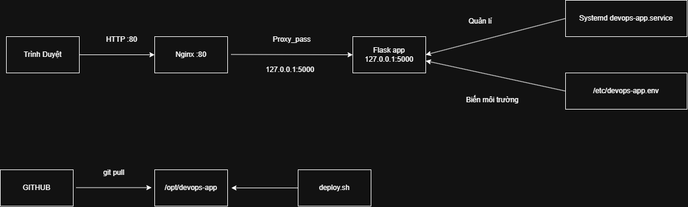

# DevOps Challenge 1: Từ triển khai thủ công đến triển khai tự động

## 1. Tổng quan dự án

| Thông tin | Nội dung |
|---|---|
| Tên nhóm | **Ngọc Lam Mỹ** |
| Thành viên | Nguyễn Ánh Ngọc |
| | Trương Thủy Lam |
| | Nguyễn Thị Quỳnh Mỹ |
| Môi trường | WSL2 Ubuntu (đã bật systemd) trên Windows |
| Repo | https://github.com/quynhmuy/devops-challenge-1 |
| Video demo | [dán link YouTube Unlisted hoặc cloud drive vào đây] |

**Mục tiêu:** triển khai một ứng dụng web Flask nhỏ lên Ubuntu, rồi cải tiến quy trình từng bước:

> Thủ công → Chạy bằng systemd → Nginx reverse proxy → Tách cấu hình → Script tự động → Health check

Kết quả là quy trình triển khai **lặp lại được, quản lý được và chẩn đoán được lỗi**.

---

## 2. Kiến trúc hệ thống

```
Trình duyệt --HTTP :80--> Nginx --proxy_pass--> Flask (127.0.0.1:5000)
                                                   ^
                            systemd (devops-app) --+-- đọc /etc/devops-app.env

GitHub --git pull--> /opt/devops-app <-- scripts/deploy.sh
```



- **Nginx** nhận request ở cổng 80 và chuyển tiếp vào Flask.
- **Flask** chỉ nghe ở `127.0.0.1:5000`, nên bên ngoài chỉ truy cập được qua Nginx.
- **systemd** giữ Flask luôn chạy, tự khởi động lại khi lỗi và tự chạy khi bật máy.
- **Cấu hình** nằm ở `/etc/devops-app.env`, tách khỏi mã nguồn.

| Thư mục | Vai trò | Làm gì ở đó |
|---|---|---|
| `~/devops-challenge-1` | Bản **phát triển** | Sửa code, commit, push |
| `/opt/devops-app` | Bản **triển khai** | Chỉ `git pull` và chạy (qua `deploy.sh`) |

---

## 3. Cấu trúc thư mục

```
devops-challenge-1/
├── app.py                  # Ứng dụng Flask
├── requirements.txt        # Thư viện Python
├── README.md               # Tài liệu này
├── scripts/
│   └── deploy.sh           # Script triển khai tự động
├── nginx/
│   └── devops-app.conf     # Cấu hình Nginx
├── systemd/
│   └── devops-app.service  # File service systemd
└── docs/
    └── architecture.png    # Sơ đồ kiến trúc
```

---

## 4. Cài đặt thủ công

**Bước 1: Cài các gói cần thiết**
```bash
sudo apt update
sudo apt install -y git python3 python3-venv python3-pip nginx curl
```

**Bước 2: Lấy mã nguồn và cài thư viện**
```bash
sudo mkdir -p /opt/devops-app
sudo chown $USER:$USER /opt/devops-app
git clone https://github.com/quynhmuy/devops-challenge-1.git /opt/devops-app
cd /opt/devops-app
python3 -m venv venv
source venv/bin/activate
pip install -r requirements.txt
```

**Bước 3: Chạy thử**
```bash
python app.py
curl http://127.0.0.1:5000
```

**Phần phản ánh:** các bước thủ công gồm clone, tạo venv, kích hoạt venv, cài thư viện, chạy app, kiểm tra. Gần như tất cả đều tự động hóa được; chỉ quyết định "khi nào deploy" là do con người.

**Bước 4: Tạo file biến môi trường** (nằm ngoài Git)
```bash
sudo tee /etc/devops-app.env > /dev/null <<'EOF'
APP_NAME=DevOps Challenge 1
APP_ENV=production
APP_PORT=5000
EOF
```

**Bước 5: Cài service systemd**

> Dòng `User=` trong `systemd/devops-app.service` phải đổi thành **username Linux của máy bạn** (kiểm tra bằng `whoami`).

```bash
sudo cp systemd/devops-app.service /etc/systemd/system/
sudo systemctl daemon-reload
sudo systemctl enable --now devops-app
```

**Bước 6: Cài Nginx**
```bash
sudo cp nginx/devops-app.conf /etc/nginx/sites-available/devops-app
sudo ln -sf /etc/nginx/sites-available/devops-app /etc/nginx/sites-enabled/devops-app
sudo rm -f /etc/nginx/sites-enabled/default
sudo nginx -t
sudo systemctl restart nginx
```

---

## 5. Cách chạy ứng dụng

| Mục đích | Lệnh |
|---|---|
| Chạy trực tiếp (phát triển) | `python app.py` |
| Chạy bằng service (production) | `sudo systemctl start devops-app` |
| Truy cập qua Nginx | `curl http://localhost` |

---

## 6. Cách triển khai

```bash
/opt/devops-app/scripts/deploy.sh
```

Script chạy được **từ bất kỳ thư mục nào**, gồm 5 bước:

| Bước | Việc làm |
|---|---|
| 1 | `git pull origin main`: cập nhật mã nguồn |
| 2 | `pip install -r requirements.txt`: cài thư viện |
| 3 | `sudo systemctl restart devops-app`: khởi động lại ứng dụng |
| 4 | Kiểm tra service đang `active` |
| 5 | Health check `http://localhost/health` (thử lại tối đa 5 lần) |

**Quy trình đầy đủ:** sửa code ở `~/devops-challenge-1` → `git add` → `git commit` → `git push` → chạy `deploy.sh` → `curl http://localhost` để thấy thay đổi.

---

## 7. Health check

Endpoint `GET /health` trả về:
```json
{"status": "ok"}
```

```bash
curl --fail http://localhost/health
```

**Health check thất bại = deploy thất bại.** Khi kiểm tra không đạt, `deploy.sh` in `Deployment FAILED` và thoát với mã **1**. Đã kiểm chứng bằng cách tạm đổi URL sang `/healthx`: script thử 5 lần, báo thất bại và `echo $?` ra `1`.

---

## 8. Quản lý service

| Việc | Lệnh |
|---|---|
| Khởi động / dừng / restart | `sudo systemctl start\|stop\|restart devops-app` |
| Bật / tắt tự chạy khi boot | `sudo systemctl enable\|disable devops-app` |
| Xem trạng thái | `systemctl status devops-app --no-pager` |
| Kiểm tra đã enable chưa | `systemctl is-enabled devops-app` |
| Xem log | `journalctl -u devops-app -n 30 --no-pager` |

**Vì sao dùng service thay vì chạy trong terminal?**
- Không phụ thuộc cửa sổ terminal, đóng terminal app vẫn chạy.
- Tự khởi động lại khi lỗi (`Restart=always`).
- Tự chạy khi bật máy (`enable`).
- Có log tập trung (`journalctl`).
- Quản lý thống nhất bằng `systemctl`.

**Vì sao tách cấu hình khỏi mã nguồn?**
- Mỗi môi trường (dev, production) cần giá trị khác nhau mà không phải sửa code.
- Mật khẩu và thông tin bí mật không bị lộ lên Git.
- Đổi cấu hình không cần commit hay build lại.

---

## 9. Git workflow

Nhánh tính năng: `feature/ngoc-lam-my`. Đã sửa `app.py`, commit và merge vào `main`.

```
Working directory --git add--> Staging area --git commit--> Local repository --git push--> GitHub
```

---

## 10. Ghi chú xử lý sự cố

### Sự cố A: 502 Bad Gateway
| Mục | Nội dung |
|---|---|
| Triệu chứng | `curl http://localhost` trả về 502 |
| Chẩn đoán | `systemctl status devops-app` (inactive); `journalctl -u devops-app`; `sudo tail /var/log/nginx/error.log` (Connection refused tới 127.0.0.1:5000); `ss -tlnp \| grep 5000` (trống) |
| Nguyên nhân | Service Flask không chạy, Nginx không có backend |
| Cách sửa | `sudo systemctl start devops-app` |

### Sự cố B: Port 5000 chạy nhưng port 80 lỗi
| Mục | Nội dung |
|---|---|
| Triệu chứng | `curl 127.0.0.1:5000` được, `curl localhost` bị từ chối kết nối |
| Chẩn đoán | `systemctl status nginx`; `sudo nginx -t`; `ss -tlnp \| grep -E ':80\|:5000'` |
| Nguyên nhân 1 | Nginx bị dừng (`nginx -t` vẫn OK). Sửa: `sudo systemctl start nginx` |
| Nguyên nhân 2 | Config sai: `nginx -t` báo `invalid number of arguments in "proxy_pass" directive ... devops-app:7` (thiếu dấu `;`), `restart` thất bại. Sửa: chép lại config đúng từ repo, chạy `nginx -t`, rồi restart |
| Bài học | **Luôn chạy `sudo nginx -t` trước khi restart** |

### Sự cố C: Ứng dụng không tự chạy sau khi reboot
| Mục | Nội dung |
|---|---|
| Triệu chứng | Sau khi khởi động lại, `curl localhost` trả về 502 |
| Chẩn đoán | `systemctl status devops-app` (inactive); `systemctl is-enabled devops-app` (disabled); `ss -tlnp` (không có port 5000) |
| Nguyên nhân | Service chưa được `enable` nên không tự chạy khi boot |
| Cách sửa | `sudo systemctl enable --now devops-app` |
| Ghi chú | `start` chỉ chạy ngay lúc đó; `enable` mới giúp tự chạy mỗi lần khởi động |

### Sự cố D: Vẫn hiện phiên bản cũ
| Mục | Nội dung |
|---|---|
| Triệu chứng | `deploy.sh` báo thành công nhưng `curl` vẫn hiện v2 |
| Chẩn đoán | `deploy.sh` in "Already up to date"; `git log --oneline` và `git status` ở bản dev cho thấy commit v3 và "ahead of 'origin/main' by 1 commit"; `/opt/devops-app` ở nhánh `main` nhưng thiếu commit mới |
| Nguyên nhân | Commit chưa được push lên GitHub |
| Cách sửa | `git push origin main`, rồi chạy lại `deploy.sh` |

### Sự cố E: deploy.sh chỉ chạy được từ một thư mục
| Mục | Nội dung |
|---|---|
| Triệu chứng | Script dùng `cd ../` chạy được từ `scripts/` nhưng lỗi từ `~` (`fatal: not a git repository`, mã thoát 128) |
| Nguyên nhân | Dùng đường dẫn tương đối, phụ thuộc thư mục đang đứng |
| Cách sửa | Tính đường dẫn từ vị trí của chính script |

```bash
SCRIPT_DIR="$(cd "$(dirname "${BASH_SOURCE[0]}")" && pwd)"
APP_DIR="$(cd "$SCRIPT_DIR/.." && pwd)"
cd "$APP_DIR"
```

---

## 11. So sánh: thủ công và tự động

| Tiêu chí | Thủ công | Tự động (`deploy.sh`) |
|---|---|---|
| Số lệnh phải gõ | Nhiều, dễ quên bước | 1 lệnh |
| Độ lặp lại | Phụ thuộc người làm | Giống nhau mỗi lần |
| Phát hiện lỗi | Phải tự kiểm tra | Health check tự động, lỗi thì `exit 1` |
| Khi máy khởi động lại | Phải chạy lại tay | systemd tự chạy |
| Chẩn đoán sự cố | Khó | Có log, status, quy trình rõ ràng |